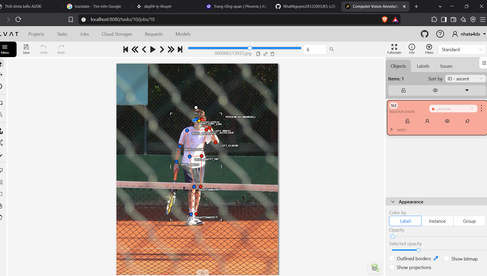
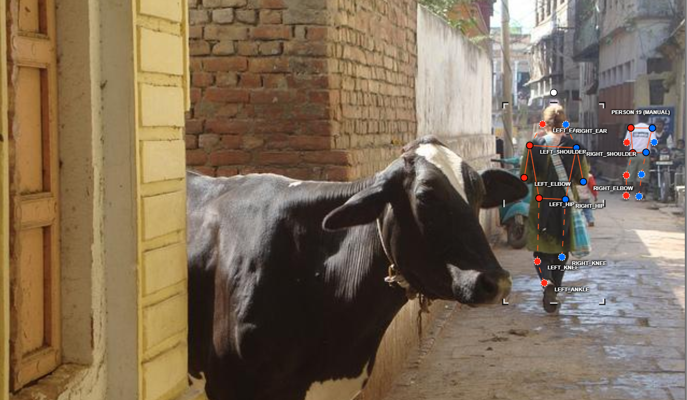
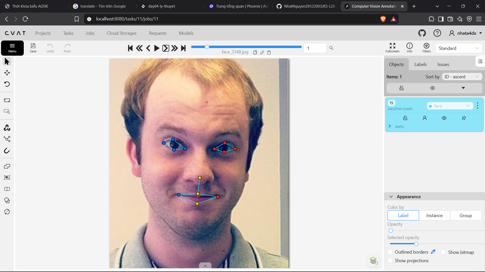
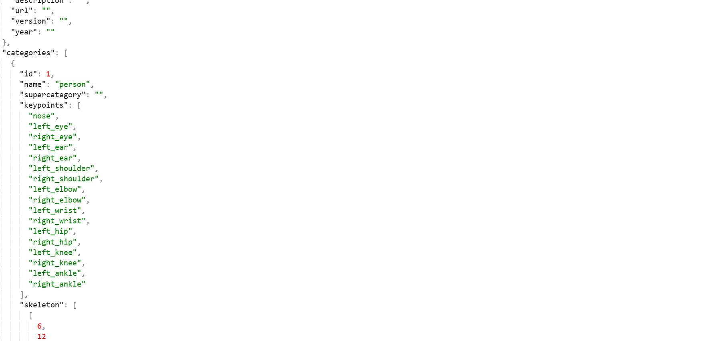

# Báo cáo cá nhân — HoVaTen-MSSV

Đổi tên file theo quy tắc `MSSV_HoTen.md`. Ví dụ: `20241234_NguyenVanAn.md`.

Dữ liệu: 12 ảnh người COCO val2017 (Lin et al., 2014) và 8 ảnh chân dung Wikimedia Commons, chỉ dùng trong lớp.

## 0. Thông tin học viên

- Họ tên: Nguyễn Văn Nhất
- MSSV: 2A2026032273
- Email:26ai.nhatnv@vinuni.edu.vn
- Link repository:https://github.com/NhatNguyen28122003/K5-L2B-Day04-NguyenVanNhat-2A202603273-KeypointPose-Student
- Phiên bản CVAT (Help → About): 2.74.1
- Máy: hệ điều hành Win · RAM 16 GB · chạy CVAT chế độ đầy đủ
- Bộ ảnh (`src/exports/assignment.json` do `lab.py setup` tạo): có
- Giờ bắt đầu: 4:30
- Giờ kết thúc: 6:30

## 1. Kiểm tra label (CP0)

| Label | Kiểu | Số điểm | Tên điểm đúng bảng của lab? | Đúng thứ tự? | Số cạnh |
|---|---|---:|---|---|---:|
| `person` |skeleton |17 |Có |Có |19 |
| `face` |skeleton |13 |Có | Có|13 |

Mẫu `person` dựng theo người quay mặt về camera (các điểm `left_*` nằm bên phải khung mẫu)? Có

Cách đổi cờ `occluded` / `outside` cho **một điểm** trên phiên bản CVAT này (một câu):

Rê chuột vào đúng điểm rồi bấm Q để bật occluded (v = 1) hoặc O để bật outside (v = 0) (Chỉ đổi điểm đó các điểm khác giữ nguyên)

## 2. Số lượng đã gán và thời gian (CP1, CP2)

| Nhóm ảnh | Số ảnh | Số skeleton đã gán | Số người dưới 60 px (không gán) | Số poster / gương / màn hình bỏ qua | Thời gian (phút) |
|---|---:|---:|---:|---:|---:|
| `easy` | 5 | 6|0 |0 | 30|
| `occluded` | 3 |6 |0 |0 |30 |
| `back` | 2 | 4|0 |0 |10 |
| `small` | 1 | 2|0 |0 |5|
| `crowd` | 1 | 3|0 |0 |20 |
| `faces` | 8 | 8| — |0 |15 |

- Số ảnh người đã xong ở mốc phút 105: 8 / 10
- Thời gian thực tế (phút): CP1 60 · CP2 60 · CP3 20
- Ảnh tốn thời gian nhất là ảnh nào, vì sao?
`000000326480.jpg` (nhóm `crowd`): ảnh có nhiều người nhất bộ (3 skeleton), người đứng gần nhau nên phải tách khớp của từng người và đặt cờ cho các khớp bị che. Ảnh `000000508269.jpg` cũng tốn thời gian: 2 người, một người bị cắt khung (phần thấy được chỉ cao 43 px), người còn lại có cặp knee/ankle phải kiểm trái/phải.
...

## 3. Bảng ca khó (CP1, CP2)

Mỗi điểm bạn phân vân một dòng, nhất là phân vân giữa `v = 1` và `v = 0`, hoặc không chắc hướng người.

| Ảnh | Người / mặt | Điểm | Cờ đã chọn | Phân vân giữa | Lý do chọn |
|---|---|---|---:|---|---|
| 000000103970.jpg | #1 | nose, left_eye, right_eye (và toàn bộ `left_*`/`right_*`) | 2 | Người quay mặt hay quay lưng | Thấy rõ mũi và hai mắt (v = 2) nhưng đã gán `left_*` bên trái ảnh như người quay lưng; script nghi `lr_swap` cả người |
| 000000508269.jpg | #1 | left/right_knee, left/right_ankle | 2 | Chân bắt chéo thật hay đổi nhầm trái/phải | Cặp knee, ankle nằm ngược phía so với vai, hông |
| 000000508269.jpg | #2 | toàn bộ skeleton | — | Gán hay không gán | Các điểm chỉ trải cao 43 px (< 60 px); giữ vì người bị cắt khung, người thật cao hơn 60 px |
| 000000580257.jpg | #1 | left_ankle, right_ankle | — | Chân bắt chéo thật hay đổi nhầm trái/phải | Cặp ankle nằm ngược phía so với các cặp còn lại (ảnh nhóm `occluded`) |

## 4. Bảng tự review (CP3)

Đi từ ảnh cuối về ảnh đầu. 5 ảnh người (ít nhất 2 ảnh `back` hoặc `crowd`) và 3 ảnh mặt. Ít nhất 8 dòng, kể cả dòng `ok`. Ghi lỗi trước, sửa sau.

Mã lỗi dùng đúng một trong: `lr_swap`, `vis_flag`, `position`, `missing`, `extra`, `ok`.

| Ảnh | Người / mặt | Điểm | Mã lỗi | Ghi chú | Đã sửa? |
|---|---|---|---|---|---|
| 000000326480.jpg | #1–#3 (`crowd`) | — | `ok` | 3 skeleton, không có cảnh báo | — |
| 000000100510.jpg | #1–#2 (`small`) | — | `ok` | 2 skeleton, không có cảnh báo | — |
| 000000351176.jpg | #1–#2 (`back`) | — | `ok` | Quay lưng, không có cảnh báo hướng | — |
| 000000023424.jpg | #1–#2 (`back`) | — | `ok` | Quay lưng, không có cảnh báo hướng | — |
| 000000580257.jpg | #1 | left_ankle, right_ankle | `lr_swap` | Cặp ankle ngược phía so với các cặp khác; nếu chân bắt chéo thật thì là `ok` | Chưa |
| 000000508269.jpg | #1 | knee, ankle (2 cặp) | `lr_swap` | Cặp knee, ankle ngược phía; nếu chân bắt chéo thật thì là `ok` | Chưa |
| 000000508269.jpg | #2 | — | `ok` | Chỉ trải cao 43 px vì bị cắt khung; người thật > 60 px | — |
| 000000103970.jpg | #1 | toàn bộ `left_*`/`right_*` | `lr_swap` | Thấy rõ mặt (quay về camera) nhưng `left_*` nằm bên trái ảnh | Chưa |
| face_560526.jpg | mặt 1 | — | `ok` | Đủ 13 điểm, không có cảnh báo | — |
| face_219250.jpg | mặt 1 | — | `ok` | Đủ 13 điểm, không có cảnh báo | — |
| face_556064.jpg | mặt 1 | — | `ok` | Đủ 13 điểm, không có cảnh báo | — |

Tổng hợp số lỗi theo mã:

| `lr_swap` | `vis_flag` | `position` | `missing` | `extra` | `ok` |
|---:|---:|---:|---:|---:|---:|
| 3 | 0 | 0 | 0 | 0 | 8 |

Điểm còn phân vân giữa `v = 1` và `v = 0` (ghi cả hai lựa chọn và lý do chọn):

Ở ảnh người có 59 điểm v = 1 (17%) và 55 điểm v = 0 (15%). Quy tắc đã dùng: khớp nằm trong ảnh nhưng bị che thì chọn v = 1 (vẫn ước lượng được vị trí); khớp nằm ngoài khung ảnh thì chọn v = 0. Ca phân vân là `000000508269.jpg` #2 (người bị cắt khung): phần cơ thể ngoài khung chọn v = 0 chứ không phải v = 1, vì điểm không nằm trong ảnh. Ở ảnh mặt không có điểm v = 0 (cả 13 điểm của mọi mặt đều trong ảnh); 17 điểm bị che (tóc, góc nghiêng) chọn v = 1.

## 5. Kiểm file xuất và kết quả tự kiểm (CP4)

Tự kiểm tay trong file JSON:

| File | Người / mặt kiểm (ảnh, thứ tự) | Số phần tử `keypoints` | Điểm `outside` ra `v = 0`, `occluded` ra `v = 1`? | `num_keypoints` khớp? |
|---|---|---:|---|---|
| `NguyenVanNhat_persons.zip` | 000000508269.jpg, #2 | 51 | Có | Có |
| `NguyenVanNhat_persons.zip` | 000000580257.jpg, #1 | 51 | Có | Có |
| `NguyenVanNhat_faces.zip` | face_556064.jpg, mặt 1 | 39 | Có (không có điểm `outside`) | Có (13) |

Sau khi xuất, CVAT ghi `occluded` thành `v = 1` và `outside` thành `v = 0`. Tọa độ của điểm `outside` trong file là `0, 0` hay tọa độ cũ? Tọa độ cũ

Hai job đã chuyển sang completed trên CVAT? Có 

Dán phần **TÓM TẮT** in ra từ `src/check_submission.py`:

```text
----- TÓM TẮT (dán vào báo cáo mục 5) -----
- File person: NguyenVanNhat_persons.zip
  Số ảnh: 12 · số skeleton `person`: 21 · mỗi annotation 51 số
  Skeleton theo ảnh: 000000023424=2, 000000100510=2, 000000103970=1, 000000109010=2, 000000150500=1, 000000205650=1, 000000213933=1, 000000326480=3, 000000351176=2, 000000467300=2, 000000508269=2, 000000580257=2
  Cờ v: v=2 243 (68%) · v=1 59 (17%) · v=0 55 (15%)
  num_keypoints trung bình: 14.4
- File face: NguyenVanNhat_faces.zip
  Số ảnh: 8 · số skeleton `face`: 8 · mỗi annotation 39 số
  Skeleton theo ảnh: face_219250=1, face_3348=1, face_380639=1, face_416730=1, face_425647=1, face_556064=1, face_560526=1, face_79591=1
  Cờ v: v=2 87 (84%) · v=1 17 (16%) · v=0 0 (0%)
  num_keypoints trung bình: 13.0
- Ghi chú: 55 điểm v = 0 vẫn mang tọa độ cũ (CVAT 2.x xuất như vậy; chuẩn COCO ghi 0, 0). Không phải lỗi: điểm v = 0 bị bỏ qua khi huấn luyện và khi chấm.
- Số [LỖI]: 0 · số [CẢNH BÁO]: 4
Kết quả: ĐẠT (đọc lại từng cảnh báo ở trên)
```

Các `[CẢNH BÁO]` còn giữ nguyên và lý do:
  [CẢNH BÁO] 000000103970.jpg #1: thấy rõ mũi và hai mắt (v = 2) nhưng các điểm left nằm bên TRÁI ảnh, tức là gán như người quay lưng. Kiểm lại hướng người (`lr_swap` cả người?).
  [CẢNH BÁO] 000000508269.jpg #1: cặp knee, ankle nằm ngược phía so với các cặp còn lại. Có thể đổi trái/phải một cặp (`lr_swap`), hoặc tay / chân bắt chéo thật: kiểm lại.
  [CẢNH BÁO] 000000508269.jpg #2: các điểm chỉ trải cao 43 px (< 60 px). Người dưới 60 px không gán; nếu người cao hơn nhưng bị cắt khung thì bỏ qua cảnh báo này.
  [CẢNH BÁO] 000000580257.jpg #1: cặp ankle nằm ngược phía so với các cặp còn lại. Có thể đổi trái/phải một cặp (`lr_swap`), hoặc tay / chân bắt chéo thật: kiểm lại.
...

## 6. Ảnh chụp màn hình

1. Label `person` trong label constructor (đủ 17 điểm có tên):

   

2. Một người quay lưng đã gán, cờ đã đặt:

   

3. Một khuôn mặt đã gán 13 điểm, phóng to vùng mắt:

   

4. Một đoạn JSON xuất của một người:

   

Nguồn ảnh: COCO val2017 / Wikimedia Commons.

## 7. Tự đánh giá

1. Lỗi bạn mắc nhiều nhất hôm nay, và cách bạn sẽ tránh ở dự án thật:

   Lỗi trái/phải (`lr_swap`): 3 trong 4 cảnh báo của script (103970 #1 cả người; 508269 #1 knee/ankle; 580257 #1 ankle). Cách tránh: trước khi đặt điểm, xác định hướng người (thấy mặt → quay về camera → `left_*` nằm bên phải ảnh); sau khi xong mỗi người, kiểm vai, hông, gối, cổ chân có cùng phía không; luôn chạy `check_submission.py` trước khi đóng job.

2. Một quy tắc bạn đề xuất thêm vào guideline (kèm ảnh ví dụ nếu có):

   Khi hai chân bắt chéo hoặc bị che (như `000000580257.jpg`, `000000508269.jpg`), xác định trái/phải bằng cách dò theo đường đùi → ống chân từ hông xuống, không dựa vào vị trí cổ chân bên trái hay bên phải ảnh; ghi ca đó vào bảng ca khó để reviewer không nhầm với `lr_swap`.

3. Nhãn của bạn đi vào model ở đâu? Chọn một lỗi bạn đã sửa và nói nó sẽ làm model học sai thế nào (heatmap, trọng số trong loss, hay bước lật ảnh):

   Lỗi `lr_swap` cả người ở `000000103970.jpg` #1. Mỗi keypoint là một kênh heatmap riêng; nếu đổi trái/phải, đỉnh Gaussian của kênh `left_shoulder` nằm ở vai phải, model bị phạt khi dự đoán đúng. Ở bước lật ảnh (augmentation), pipeline đổi kênh trái ↔ phải theo `flip_pairs`, nên nhãn sai vẫn sai sau khi lật, làm model học rằng trái/phải không gắn với hướng người và dễ đổi trái/phải với người quay mặt. Ngược lại, 55 điểm v = 0 dù mang tọa độ cũ không gây hại vì có trọng số 0 trong loss.

## 8. Khó khăn và lỗi kỹ thuật
- Script tự kiểm báo 4 cảnh báo (0 lỗi); phải mở lại từng ảnh để phân biệt lỗi trái/phải thật với chân bắt chéo thật hoặc người bị cắt khung.
- 55 điểm `outside` (v = 0) xuất ra vẫn mang tọa độ cũ thay vì `0, 0` như chuẩn COCO; đã xác nhận đây là cách CVAT 2.x xuất, không phải lỗi.
- Ảnh `crowd` (3 người) và ảnh có người bị cắt khung tốn nhiều thời gian nhất.


## 9. Tài liệu tham khảo và công cụ AI đã dùng
- Công cụ AI: Claude (Anthropic), dùng để hỗ trợ trình bày báo cáo; nhãn do tôi tự gán trên CVAT.
